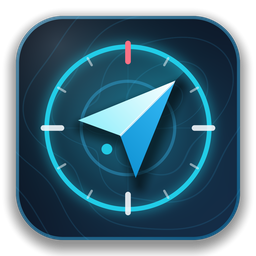

<div align="center">



# 🗺️ ZiloreMiniMap

**Next-Generation Tactical Minimap, Offline Road Navigator & Squad Radar for SCUM**

[](README.md)
[](README.en.md)

<a href="https://github.com/Zilore-Anatoliy/ZiloreMiniMap/releases"></a>
[](https://github.com/Zilore-Anatoliy/ZiloreMiniMap/releases)
[](https://dotnet.microsoft.com/)
[](SECURITY.md)
[](SECURITY.md)

[📥 Download Latest Release](https://github.com/Zilore-Anatoliy/ZiloreMiniMap/releases) · [📖 Full User Guide](docs/USER-GUIDE-EN.md) · [❓ FAQ](docs/FAQ.md) · [💬 Discord (SCUM GRAND)](https://discord.gg/xbWXKahvS) · [🧡 Support & Donate](#-support-the-project--donate)

</div>

---

## 📋 Table of Contents

1. [What is ZiloreMiniMap?](#-what-is-ziloreminimap)
2. [Why is it Safe for Easy Anti-Cheat (EAC)?](#-why-is-it-safe-for-easy-anti-cheat-eac)
3. [Key Features in the Current Build](#-key-features-in-the-current-build)
4. [Quick Start & Installation](#-quick-start--installation)
5. [1-Minute SCUM Setup](#-1-minute-scum-setup)
6. [Hotkeys & Controls](#-hotkeys--controls)
7. [Digital Signature & Integrity Verification](#-digital-signature--integrity-verification)
8. [Extended Access (POI & Zilore AI)](#-extended-access-poi--zilore-ai)
9. [Support the Project & Donate](#-support-the-project--donate)
10. [Support, Feedback & Bug Reports](#-support-feedback--bug-reports)

---

## 🎯 What is ZiloreMiniMap?

**ZiloreMiniMap** is a lightweight, high-performance overlay companion for **SCUM** on **Windows 10 / 11 (x64)** built with modern **Windows 11 Fluent Design**. It provides a smooth customizable minimap (HUD), full-screen tactical map, offline island road navigation, live squad tracking, SCUM server clock calibration, climate awareness, and survival tracking — **without ever touching game files or game memory**.

> Made with love in the Republic of Belarus · Built for SCUM players and the **SCUM GRAND** community.

---

## 🛡️ Why is it Safe for Easy Anti-Cheat (EAC)?

ZiloreMiniMap is engineered from the ground up for strict anti-cheat compliance:

* **Zero game memory access:** never calls `ReadProcessMemory`, `WriteProcessMemory`, or debugging APIs.
* **Zero DLL injection or graphics hooking:** does not hook DirectX or Vulkan.
* **Passive coordinate reading:** relies solely on SCUM's built-in, developer-provided **Copy Location** hotkey (`Num /`) while displaying cleanly above SCUM in **Borderless Windowed** mode.
* **Passive screen sampling (optional):** survival and sky/rain detectors capture only small screen regions via standard OS graphics APIs (similar to OBS Studio or Discord).

See [SECURITY.md](SECURITY.md) for our complete security policy and verification instructions.

---

## ✨ Key Features in the Current Build

### 🧭 Minimap (HUD) & Tactical Map (`M`)
* **Silky 60–144+ Hz Rendering:** Zero-GC hot-path rendering and seamless high-resolution terrain tile streaming without stutters.
* **Flexible HUD Modes:** Choose between a sleek **circular radar** with compass ticks or a **square minimap**, with free resizing, repositioning, and opacity control (`0–100%`).
* **Speed-Adaptive Auto-Zoom:** Automatically zooms out when driving or flying and zooms back in on foot.
* **2K / 4K GPU Hardware Acceleration:** Optional direct GPU rendering (`DirectTerrain`) for crisp, smooth performance on high-DPI / 4K displays.
* **Tactical Map Suite:** Map rotation with player heading, velocity projection vector, sector grid, movement trail history, death markers, smart POI clustering, smart label LOD, instant search, and **distance + bearing ruler**.

### 🛣️ Offline Road Navigator, Aviation & Voice Guidance
* **Offline Road Routing:** Computes real road routes across the SCUM island with automatic **danger zone avoidance** (PvP, radiation, custom restricted zones).
* **Multi-Stop Routes (up to 16 stops):** Plan complex loot runs, auto-optimize stop order in one click, and share routes with friends using compact **`ZLR-ROUTE`** codes in Discord.
* **Aviation Mode (✈):** Automatic flight detection (`> 110 km/h`), runway markers (including custom runways), heading vector, and altitude display.
* **Built-In Voice Guidance:** Offline voice packs with selectable Windows audio output device.

### 👥 Squad Mode (Team Radar)
* **Real-Time Squad Sync:** Share live positions, waypoints, GPS targets, death markers, routes, and fading tactical pings with your team.
* **Two Connection Modes:** Secure private relay groups via invite code or direct P2P connections.
* **Live Connection Quality Indicator:** Instant status for every squadmate (`●` online / `◐` delayed / `○` offline).
* **Granular Squad Controls:** Per-player layer visibility toggles, Squad Leader designation (`★`), and one-click teammate follow mode.

### 🕒 SCUM Server Clock, Climate & Weather
* **Server Clock Calibration:** Sync in-game time with any SCUM server using presets (`1x`, `3.84x Official`, `4x`, `6x`, `8x`, or custom `TimeOfDaySpeed`) with zero-jump adjustment.
* **Island Climate Model:** Estimates local temperature by map region, elevation, and time of day, with hypothermia risk alerts.
* **Passive Sky & Rain Detector** (optional, EAC-Safe): Helps detect incoming rain and overcast conditions.

### 🤖 Zilore AI — Survival Companion
* **Passive Survival Bar Tracker:** Monitors health, energy, and hydration trends from the HUD (with full multi-monitor support).
* **Adaptive ETA Estimation:** Dynamically computes arrival time based on live movement speed and route geometry.

### 🧩 Custom Zones, Profile Backup & Admin Tools
* **Custom Zones & Packs:** Import zones from `.tsv` files or map screenshots, save map presets, and toggle layers quickly with `Alt+1–5`.
* **1-Click Profile Backup & Restore:** Export all settings, waypoints, routes, custom zones, and runways into a single Desktop ZIP backup and restore anytime.
* **Optional Server Admin Suite:** Password-protected admin console with custom commands, directional teleport, player database, and a visual **Spawn Cart**.

### 🎨 Windows 10 / 11 Fluent Design & Day/Night Icons
* **4 Live Themes:** `System` (auto-syncs with Windows), `Dark`, `OLED`, and `Light` — instant switching without restarting.
* **Adaptive HD/4K Day/Night Icons:** System tray, taskbar, `Alt+Tab`, and window title-bar icons automatically adapt to your Windows Light or Dark theme.
* **Built-In Auto-Updater:** Secure HTTPS updates with SHA-256 digest verification while keeping all user data intact.

---

## 🚀 Quick Start & Installation

### System Requirements
* **OS:** Windows 10 (64-bit) or Windows 11 (64-bit)
* **Game:** SCUM set to **Borderless / Windowed Fullscreen** mode
* **Dependencies:** **None** — self-contained `.NET 10 LTS` runtime is included.

### Option 1: Installer (Recommended)
1. Go to **[Releases](https://github.com/Zilore-Anatoliy/ZiloreMiniMap/releases)** and download **`ZiloreMiniMap-Setup-v0.0.1.exe`**.
2. Run the installer — no administrator privileges are required (installs per-user).
3. Updating over an older version **automatically preserves all your settings, waypoints, routes, zones, and runways**.

### Option 2: Portable Version (ZIP Archive)
1. Download **`ZiloreMiniMap.zip`** from **[Releases](https://github.com/Zilore-Anatoliy/ZiloreMiniMap/releases)**.
2. Extract it to any folder (e.g. `D:\Games\ZiloreMiniMap`).
3. Launch **`ZiloreMiniMap.exe`**.

> **If Windows SmartScreen shows a "Windows protected your PC" prompt:**
> This is normal for newly published releases signed with an independent developer certificate. Click **More info → Run anyway**, or verify the digital signature and SHA-256 checksum first using the steps below.

---

## 🎮 1-Minute SCUM Setup

On first launch, the **Setup Wizard** guides you through every step automatically:

1. **SCUM Display Mode:** Go to *Settings → Video* in SCUM and select **Windowed Fullscreen / Borderless** (overlays cannot draw over exclusive fullscreen).
2. **Coordinate Key:** In SCUM *Settings → Controls*, verify **Copy Location** is bound to **`Num /`** (or bind a custom key in the wizard if you use a tenkeyless/compact keyboard).
3. **Join a Server:** The minimap immediately tracks your position, heading, and current grid sector.

Read the complete **[User Guide (English)](docs/USER-GUIDE-EN.md)** and **[FAQ](docs/FAQ.md)** for full details.

---

## ⌨️ Hotkeys & Controls

| Key / Action | Description |
|---|---|
| **`M`** *(customizable)* | Toggle full-screen tactical map |
| **`Num /`** *(customizable)* | SCUM's built-in *Copy Location* key for position sync |
| **`Alt + 1` … `Alt + 5`** | Quick-toggle map layers (zones, waypoints, POI, grid, trail) |
| **Mouse Wheel / `+` `−`** | Smooth map zoom |
| **Right-Click on Map** | Context menu: route here, add waypoint, drop squad ping, ruler measurement, add runway |
| **Drag Route Stop** | Reposition route waypoints directly on the map with live preview |
| **`Esc`** | Close active dialog / context menu |
| **Double-Click Tray Icon** | Open Settings immediately |

All keybindings can be customized in **Settings → Shortcuts**.

---

## 🔐 Digital Signature & Integrity Verification

Every official release on **[Releases](https://github.com/Zilore-Anatoliy/ZiloreMiniMap/releases)** is cryptographically signed:

* **Executables (`ZiloreMiniMap-Setup-v*.exe`, `ZiloreMiniMap.exe`):** Signed with **Authenticode (SHA-256)** and an **RFC 3161 Timestamp (TSA)**. Verify via *Right-click → Properties → Digital Signatures*.
* **ZIP Archives & Manifests (`ZiloreMiniMap.zip`, `SHA256SUMS.txt`, `update.txt`):** Accompanied by detached **CMS / PKCS#7 (`.p7s`)** signatures.
* **Public Certificate (`ZiloreCodeSigning.cer`):** Included with every release for independent verification.

Quick SHA-256 check in PowerShell:
```powershell
Get-FileHash .\ZiloreMiniMap-Setup-v0.0.1.exe -Algorithm SHA256
```
Compare the output against **`SHA256SUMS.txt`** from the same release.

---

## 🔑 Extended Access (POI & Zilore AI)

* **Free for everyone:** Minimap (HUD), tactical map, live tracking, offline road routing, squad radar, SCUM server clock, climate model, custom zones, aviation mode, voice navigation, profile backup, and all 4 Fluent themes.
* **Extended Modules (POI Database Filters & Zilore AI):** Activated using offline access keys (**1–24 hours**, **30 / 90 / 180 / 365 days**, or master key).
* Access keys can be obtained by voluntarily supporting the project via **Boosty** or **YooMoney** (details are also available inside the app under *About* and the POI activation window).

---

## 🧡 Support the Project & Donate

ZiloreMiniMap is independently developed for the SCUM community. Your voluntary support directly helps cover development tools, certificates, and ongoing updates:

* ⚡ **Boosty (Membership / Support):** [Support on Boosty](https://boosty.to/minimap.zilore.app/purchase/4184863?ssource=DIRECT&share=subscription_link)
* ♥ **YooMoney (One-Time Donation):** [Donate via YooMoney](https://yoomoney.ru/to/410013990138306)

Thank you to everyone who supports development!

---

## 💬 Support, Feedback & Bug Reports

Need help, found a bug, or want to suggest a feature?

* 📧 **Support Email:** [`support@zilore.app`](mailto:support@zilore.app)
* 💬 **SCUM GRAND Discord Community:** [Join Discord](https://discord.gg/xbWXKahvS)
* 🐞 **Bug Reports & Feature Requests:** [Open a GitHub Issue](https://github.com/Zilore-Anatoliy/ZiloreMiniMap/issues/new/choose)
* 🌐 **Official Project Page:** [minimap.zilore.app](https://minimap.zilore.app)

### Exporting a Safe Diagnostic Report
1. Open **About → Support** (or **Settings → Logs**) inside ZiloreMiniMap.
2. Click **Export Log** — this creates `ZiloreMiniMap-Diagnostics-*.zip` on your Desktop (**contains zero personal passwords or private keys**).
3. Attach that ZIP to your email to [`support@zilore.app`](mailto:support@zilore.app) or your [GitHub Issue](https://github.com/Zilore-Anatoliy/ZiloreMiniMap/issues/new/choose).

Full support guidelines are available in [SUPPORT.md](SUPPORT.md).

---

<div align="center">
<sub>© 2025–2026 Zilore · Made with ❤️ in the Republic of Belarus for SCUM players</sub>
</div>
