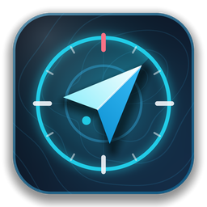

<div align="center">



# 🗺️ ZiloreMiniMap

**Тактическая миникарта, офлайн-навигатор и командный радар нового поколения для SCUM**

[](README.md)
[](README.en.md)

<a href="https://github.com/Zilore-Anatoliy/ZiloreMiniMap/releases"></a>
[](https://github.com/Zilore-Anatoliy/ZiloreMiniMap/releases)
[](https://dotnet.microsoft.com/)
[](SECURITY.md)
[](SECURITY.md)

[📥 Скачать последний релиз](https://github.com/Zilore-Anatoliy/ZiloreMiniMap/releases) · [📖 Подробное руководство](docs/USER-GUIDE-RU.md) · [❓ Частые вопросы (FAQ)](docs/FAQ.md) · [💬 Discord (SCUM GRAND)](https://discord.gg/xbWXKahvS) · [🧡 Поддержать проект](#-поддержка-проекта-и-донат)

</div>

---

## 📋 Оглавление

1. [Что такое ZiloreMiniMap?](#-что-такое-ziloreminimap)
2. [Почему это безопасно для Easy Anti-Cheat (EAC)?](#-почему-это-безопасно-для-easy-anti-cheat-eac)
3. [Все возможности текущей сборки](#-все-возможности-текущей-сборки)
4. [Актуальный релиз](#-актуальный-релиз-v001-build-00001)
5. [Быстрый старт и установка](#-быстрый-старт-и-установка)
6. [Настройка SCUM за 1 минуту](#-настройка-scum-за-1-минуту)
7. [Горячие клавиши и управление](#-горячие-клавиши-и-управление)
8. [Проверка цифровой подписи и подлинности файлов](#-проверка-цифровой-подписи-и-подлинности-файлов)
9. [Доступ к расширенным функциям (POI и Zilore AI)](#-доступ-к-расширенным-функциям-poi-и-zilore-ai)
10. [Поддержка проекта и донат](#-поддержка-проекта-и-донат)
11. [Поддержка, обратная связь и отчёты об ошибках](#-поддержка-обратная-связь-и-отчёты-об-ошибках)

---

## 🎯 Что такое ZiloreMiniMap?

**ZiloreMiniMap** — это лёгкий и быстрый оверлей-компаньон для игры **SCUM** под **Windows 10 / 11 (x64)** в современном стиле **Windows 11 Fluent Design**. Программа отображает аккуратную миникарту (HUD) и полноэкранную тактическую карту поверх игры, прокладывает реальные маршруты по дорогам острова, помогает координировать отряд, отслеживает серверное время, климат и динамику выживания — **без какого-либо вмешательства в файлы или память игры**.

> Создано с любовью в Республике Беларусь · Специально для игроков SCUM и сообщества **SCUM GRAND**.

---

## 🛡️ Почему это безопасно для Easy Anti-Cheat (EAC)?

ZiloreMiniMap спроектирована с соблюдением строгих принципов безопасности античита:

* **Не читает и не изменяет память процесса SCUM** (`ReadProcessMemory`, `WriteProcessMemory` и любые системные вызовы отладки полностью отсутствуют в коде).
* **Не внедряет DLL** и не перехватывает графику DirectX / Vulkan.
* **Пассивное получение координат:** программа использует только штатную, разрешённую разработчиками функцию SCUM **Copy Location** (`Num /`), работая поверх окна игры в режиме *«Окно без рамки» (Borderless)*.
* **Пассивный анализ HUD / неба (опционально):** модули выживания и погоды используют стандартный безопасный захват небольшой области экрана (как OBS Studio или Discord).

Подробнее о безопасности и криптографической проверке — в [SECURITY.md](SECURITY.md).

---

## ✨ Все возможности текущей сборки

### 🧭 Миникарта (HUD) и тактическая карта (`M`)
* **Плавный рендер 60–144+ Гц:** оптимизация нулевых аллокаций памяти (Zero-GC) и бесшовная подгрузка тайлов карты высокого разрешения без подвисаний.
* **Два формата HUD:** классический **круглый радар** с градуировкой компаса и **квадратная миникарта** с возможностью свободно менять размер, положение и прозрачность (`0–100%`).
* **Умный автозум по скорости:** миникарта автоматически отдаляется при езде на транспорте или полёте и приближается при ходьбе пешком.
* **Режим GPU-ускорения для 2K / 4K мониторов:** прямое аппаратное ускорение карты (`DirectTerrain`) для идеальной плавности на экранах высокого разрешения.
* **Удобные инструменты карты:** вращение по взгляду, вектор движения, сетка секторов, история пройденного пути (трек), маркеры смерти, умная кластеризация POI, интеллектуальные подписи, мгновенный поиск объектов и **линейка расстояния + азимута**.

### 🛣️ Офлайн-навигатор по дорогам, авиация и голос
* **Прокладка маршрутов по дорогам острова:** быстрый расчёт пути без интернета с автоматическим **обходом опасных зон** (PvP, радиация, пользовательские зоны).
* **Многоточечные маршруты (до 16 точек):** добавляйте промежуточные остановки, оптимизируйте порядок маршрута в один клик и делитесь готовым маршрутом с друзьями через короткий код **`ZLR-ROUTE`** в Discord.
* **Авиационный режим (✈):** автоматическое определение полёта (`> 110 км/ч`), отображение взлётно-посадочных полос (включая добавление своих ВПП), вектор курса и высота.
* **Голосовой навигатор:** встроенные офлайн голосовые подсказки с выбором конкретного аудиоустройства Windows.

### 👥 Командный режим (Отряд / Squad)
* **Совместная карта в реальном времени:** позиции тиммейтов, их маркеры, GPS-цели, метки смерти, маршруты и тактические пинги с плавным затуханием.
* **Два режима подключения:** приватные релей-группы по коду приглашения или прямое P2P-подключение.
* **Индикатор качества связи:** наглядный статус каждого бойца (`●` онлайн / `◐` задержка / `○` офлайн).
* **Гибкий контроль:** индивидуальные фильтры слоёв для каждого участника, назначение лидера отряда (`★`) и режим автоматического следования за тиммейтом.

### 🕒 Серверные часы SCUM, климат и погода
* **Калибровка серверного времени:** синхронизация с любым сервером SCUM с пресетами скорости цикла (`1x`, `3.84x Official`, `4x`, `6x`, `8x` или свой множитель) без скачков времени.
* **Климатическая модель острова:** оценка температуры с учётом координат (горы/побережье/снег), высоты и времени суток, предупреждение о риске переохлаждения.
* **Пассивный детектор неба и дождя** (опционально, EAC-Safe): помогает вовремя замечать ухудшение погоды.

### 🤖 Zilore AI — помощник выживания
* **Пассивный трекер выживания:** отслеживание динамики здоровья, энергии и гидратации на экране (с поддержкой мультимониторных конфигураций).
* **Адаптивный расчёт ETA:** оценка времени прибытия до цели с учётом текущей скорости и маршрута.

### 🧩 Пользовательские зоны, бэкап профиля и админ-инструменты
* **Пользовательские зоны и паки:** импорт зон из `.tsv`, распознавание зон со скриншотов карты, пресеты отображения и быстрые клавиши слоёв (`Alt+1–5`).
* **Бэкап и восстановление профиля в 1 клик:** сохранение всех настроек, точек, маршрутов, зон и ВПП в один ZIP-архив на Рабочий стол и мгновенное восстановление на другом ПК.
* **Панель администратора сервера (опционально):** защищена паролем; включает список быстрых команд, направленный телепорт, базу игроков и **корзину спавна предметов (Spawn Cart)**.

### 🎨 Windows 10 / 11 Fluent Design и иконки День / Ночь
* **4 темы оформления:** `Системная` (автосинхронизация с Windows), `Тёмная`, `OLED` и `Светлая` — мгновенное переключение без перезапуска программы.
* **Адаптивные HD/4K иконки День / Ночь:** иконка в системном трее, на панели задач, в `Alt+Tab` и заголовках окон автоматически подстраивается под светлую или тёмную тему Windows.
* **Встроенный автообновлятор:** безопасная проверка и установка обновлений с контролем SHA-256 и сохранением всех пользовательских данных.

---

<!-- AUTO-RELEASE-INFO:START -->
## 📦 Актуальный релиз: v0.0.1 (build 00001)

* **Дата сборки:** `2026-11-24`
* **Что нового:** • Первый релиз новой ветки `v0.0.1`: Windows 11 Fluent UI, адаптивные HD/4K иконки День/Ночь, 60–144+ Гц Zero-GC рендер, климатическая модель, офлайн-навигация и автоматическая цифровая подпись всех артефактов.

> Актуальные файлы установщика (`ZiloreMiniMap-Setup-v*.exe`), портативный архив (`ZiloreMiniMap.zip`), подписи `.p7s` и контрольные суммы `SHA256SUMS.txt` всегда доступны в разделе **[Releases](https://github.com/Zilore-Anatoliy/ZiloreMiniMap/releases)**.
<!-- AUTO-RELEASE-INFO:END -->

---

## 🚀 Быстрый старт и установка

### Системные требования
* **ОС:** Windows 10 (64-bit) или Windows 11 (64-bit)
* **Игра:** SCUM в режиме экрана **«Окно без рамки» (Borderless)**
* **Дополнительно:** установка `.NET` **не требуется** — всё необходимое уже встроено в программу (Self-Contained `.NET 10 LTS`).

### Способ 1: Установщик (рекомендуется)
1. Перейдите в раздел **[Releases](https://github.com/Zilore-Anatoliy/ZiloreMiniMap/releases)** и скачайте **`ZiloreMiniMap-Setup-v0.0.1.exe`**.
2. Запустите установщик — права администратора не требуются (программа устанавливается в профиль пользователя).
3. При обновлении поверх старой версии **все ваши настройки, точки, маршруты, зоны и ВПП полностью сохраняются**.

### Способ 2: Портативная версия (ZIP-архив)
1. Скачайте **`ZiloreMiniMap.zip`** из раздела **[Releases](https://github.com/Zilore-Anatoliy/ZiloreMiniMap/releases)**.
2. Распакуйте архив в любую удобную папку (например, `D:\Games\ZiloreMiniMap`).
3. Запустите **`ZiloreMiniMap.exe`**.

> **Если Windows SmartScreen показал синее предупреждение «Система Windows защитила ваш компьютер»:**
> Это стандартная реакция на новые сборки программ, подписанные собственным сертификатом разработчика. Нажмите **«Подробнее» → «Выполнить в любом случае»**, либо предварительно проверьте цифровую подпись и SHA-256 по инструкции ниже.

---

## 🎮 Настройка SCUM за 1 минуту

При первом запуске ZiloreMiniMap откроется пошаговый **Мастер настройки**, который проведёт вас через все пункты. Основные требования:

1. **Режим экрана в SCUM:** откройте *Настройки → Видео* и выберите **«Окно без рамки» (Windowed Fullscreen / Borderless)** (в эксклюзивном полноэкранном режиме оверлей Windows не отображается поверх игры).
2. **Клавиша копирования координат:** проверьте в *Настройки → Управление* SCUM, что на действие **Copy Location** назначена клавиша **`Num /`** (или выберите свою клавишу в мастере, если у вас клавиатура без цифрового блока Numpad).
3. **Запустите SCUM и зайдите на сервер:** миникарта автоматически начнёт отображать ваше положение, направление взгляда и ближайший сектор.

Подробный разбор всех функций и настроек читайте в **[Полном руководстве пользователя](docs/USER-GUIDE-RU.md)** и **[Частых вопросах (FAQ)](docs/FAQ.md)**.

---

## ⌨️ Горячие клавиши и управление

| Клавиша / действие | Назначение |
|---|---|
| **`M`** *(настраивается)* | Открыть / закрыть полноэкранную тактическую карту |
| **`Num /`** *(настраивается)* | Штатная клавиша SCUM *Copy Location* для синхронизации координат |
| **`Alt + 1` … `Alt + 5`** | Быстрое переключение слоёв карты (зоны, метки, POI, сетка, трек) |
| **Колесо мыши / `+` `−`** | Плавное масштабирование тактической карты |
| **ПКМ по карте** | Контекстное меню: проложить маршрут, добавить точку, поставить пинг отряда, измерить линейкой, добавить ВПП |
| **Перетаскивание точки маршрута** | Изменение положения точки маршрута прямо на карте с предпросмотром |
| **`Esc`** | Закрыть открытое окно / контекстное меню |
| **Двойной клик по иконке в трее** | Быстро открыть окно настроек |

Все горячие клавиши можно переназначить в разделе **Настройки → Клавиши**.

---

## 🔐 Проверка цифровой подписи и подлинности файлов

Каждый официальный релиз в разделе **[Releases](https://github.com/Zilore-Anatoliy/ZiloreMiniMap/releases)** автоматически подписывается цифровым сертификатом разработчика:

* **Исполняемые файлы (`ZiloreMiniMap-Setup-v*.exe`, `ZiloreMiniMap.exe`):** встроенная подпись **Authenticode (SHA-256)** с меткой времени **RFC 3161 (TSA)**. Проверить можно через *Правый клик по файлу → Свойства → Цифровые подписи*.
* **ZIP-архивы и манифесты (`ZiloreMiniMap.zip`, `SHA256SUMS.txt`, `update.txt`):** сопровождаются файлами криптографической подписи **CMS / PKCS#7 (`.p7s`)**.
* **Публичный сертификат (`ZiloreCodeSigning.cer`):** публикуется в каждом релизе для желающих проверить подпись или добавить сертификат в доверенные на своём ПК.

Быстрая проверка SHA-256 в PowerShell:
```powershell
Get-FileHash .\ZiloreMiniMap-Setup-v0.0.1.exe -Algorithm SHA256
```
Сравните полученный хэш со значением в файле **`SHA256SUMS.txt`** из того же релиза.

---

## 🔑 Доступ к расширенным функциям (POI и Zilore AI)

* **Бесплатно для всех:** миникарта (HUD), тактическая карта, трекинг, маршруты по дорогам, командный режим (отряд), серверные часы SCUM, климатическая модель, пользовательские зоны, авиационный режим, голосовой навигатор, бэкап профиля и все 4 темы оформления.
* **Расширенный доступ (фильтры базы POI и модуль Zilore AI):** активируется офлайн-ключом доступа (доступны периоды на **1–24 часа**, **30 / 90 / 180 / 365 дней** или мастер-ключ).
* Получить ключ доступа можно за добровольную поддержку развития проекта через **Boosty** или **ЮMoney** (подробности также доступны внутри программы в окне активации POI и в разделе *О программе*).

---

## 🧡 Поддержка проекта и донат

ZiloreMiniMap развивается как независимый проект для сообщества SCUM. Любая добровольная поддержка помогает оплачивать инфраструктуру, сертификаты и уделять больше времени новым функциям и обновлениям:

* ⚡ **Boosty (подписка / поддержка):** [Оформить поддержку на Boosty](https://boosty.to/minimap.zilore.app/purchase/4184863?ssource=DIRECT&share=subscription_link)
* ♥ **ЮMoney (разовый донат):** [Поддержать через ЮMoney](https://yoomoney.ru/to/410013990138306)

Спасибо каждому, кто поддерживает разработку!

---

## 💬 Поддержка, обратная связь и отчёты об ошибках

Если вы столкнулись с проблемой, нашли баг или хотите предложить новую функцию:

* 📧 **Электронная почта поддержки:** [`support@zilore.app`](mailto:support@zilore.app)
* 💬 **Discord-сообщество SCUM GRAND:** [Присоединиться к Discord](https://discord.gg/xbWXKahvS)
* 🐞 **Сообщить об ошибке / предложить идею на GitHub:** [Открыть Issue](https://github.com/Zilore-Anatoliy/ZiloreMiniMap/issues/new/choose)
* 🌐 **Официальный сайт проекта:** [minimap.zilore.app](https://minimap.zilore.app)

### Как быстро приложить лог для диагностики?
1. Откройте в программе **О программе → Поддержка** (или **Настройки → Журнал**).
2. Нажмите **«Выгрузить лог»** — на Рабочем столе создастся безопасный архив `ZiloreMiniMap-Diagnostics-*.zip` (**он не содержит ваших личных паролей и ключей**).
3. Прикрепите этот архив к обращению на [`support@zilore.app`](mailto:support@zilore.app) или в [GitHub Issue](https://github.com/Zilore-Anatoliy/ZiloreMiniMap/issues/new/choose).

Подробные правила и каналы связи — в [SUPPORT.md](SUPPORT.md).

---

<div align="center">
<sub>© 2025–2026 Zilore · Сделано с ❤️ в Республике Беларусь для игроков SCUM</sub>
</div>
